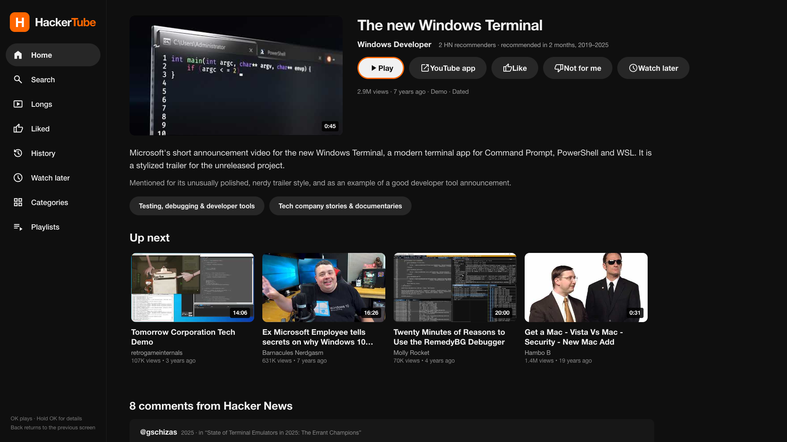
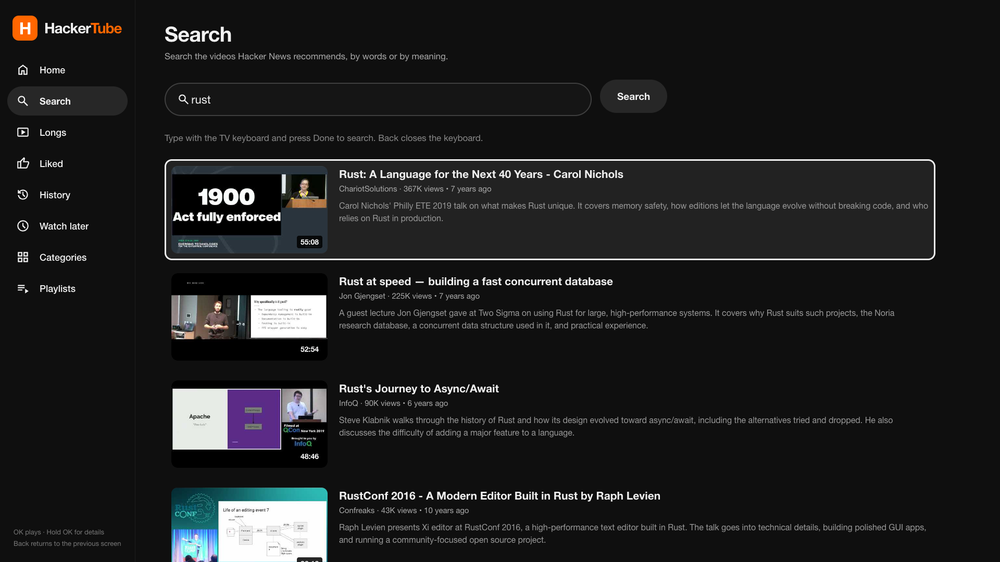
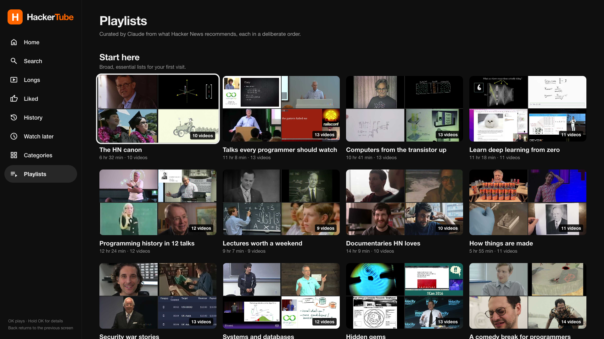

# HackerTube for Samsung TVs

A Tizen web app for [HackerTube](https://hackertube.org): the videos Hacker
News recommends, played in the YouTube app on your Samsung TV.

This is a port of the [Android TV app](https://github.com/ephraimduncan/hackertube.tv).
Samsung TVs run **Tizen**, not Android TV, so the Kotlin/Compose app cannot be
installed on them. The pages, the look and the API are the same.


## What it does

- **Home** with a chip for each topic area, like the website
- **Search** by words or by meaning
- **Longs**, **Liked**, **History** and **Watch later**
- **Categories** and **Playlists**
- A video page with the summary, why HN recommends it, HN comments and "Up next"
- OK plays a video in the TV's YouTube app; **hold OK** opens the video page
- Likes, dislikes, history and Watch later stay on the TV and shape the Home feed







## Download

Grab the latest `HackerTube.wgt` from
[Releases](https://github.com/iTzFaisal/hackertube/releases/latest), then follow
[Install on the TV](#install-on-the-tv). The package is unsigned: Tizen
Homebrew re-signs it during install, or you can sign it yourself with Tizen
Studio.

## Requirements

- A Samsung Smart TV running **Tizen 5.0 or newer** (roughly 2019 and later)
- The YouTube app installed on the TV
- A computer on the same network for the one-time install
- Node.js 20+ on that computer (only when building from source)
- A free Cloudflare account (only when deploying your own API proxy) — see below
- A Samsung developer account and/or [Tizen Homebrew](https://github.com/SushyDev/tizen-homebrew)
  for sideloading

Release builds already point at the project's deployed API proxy, so you can
skip the proxy and build sections below.

The app has been tested in Chromium at 1920×1080 and against the live
HackerTube API. It has not been tested on every Samsung firmware. The
focus handling and the YouTube handoff are the parts most likely to need a
small adjustment on an unusual model.

## Why there is a proxy

`hackertube.org` does not send CORS headers. A packaged Tizen app runs from a
`file://` origin, so the TV's webview will not let it read
`https://hackertube.org/api/*` directly.

The `proxy/` folder contains a small Cloudflare Worker that forwards only
`/api/*` to hackertube.org and adds the missing header. It is read-only and
does not store anything. Deploy it once, then build the app with its URL.

### 1. Deploy the proxy

```sh
npx wrangler login
npm run deploy:proxy
```

Wrangler prints a URL like:

```
https://hackertube-proxy.your-name.workers.dev
```

Check it in a browser:

```sh
curl "https://hackertube-proxy.your-name.workers.dev/api/feed?n=1"
```

### 2. Build the app with that URL

```sh
npm install
npm run package -- --api https://hackertube-proxy.your-name.workers.dev
```

This produces:

- `dist/HackerTube.wgt` — the installable Tizen package (unsigned)
- `build/HackerTube/` — the clean Tizen project, for Tizen Studio

The package script appends `/api` to the URL for you. You can also set
`HACKERTUBE_API_BASE` in the environment instead of passing `--api`.

```sh
npm run package:tv
```

That produces the same `dist/HackerTube.wgt` with the deployed worker. To
remove the worker from your Cloudflare account later:

```sh
npx wrangler delete --config proxy/wrangler.toml
```

> If you skip this step, the app installs but shows a **"One small setup step"**
> screen, because it has no way to reach the API.

## Install on the TV

### Option A — Tizen Homebrew (recommended)

[Tizen Homebrew](https://github.com/SushyDev/tizen-homebrew) is a third-party
homebrew installer for Samsung TVs. It creates a Samsung certificate for your
TV, re-signs packages for you, and gives you a phone interface for installing
`.wgt` files. No Tizen Studio is needed.

1. Run the installer on the computer:

   ```sh
   curl -fsSL https://sushydev.github.io/tizen-homebrew/install.sh | sh
   ```

   On Windows, use the PowerShell command in the Tizen Homebrew README.

2. Follow what it asks. In short:
   - On the TV: **Apps → press 12345 → Developer Mode ON**
   - Set **Host PC IP** to the computer's address
   - Restart the TV when asked
   - Sign in with your Samsung account if the installer asks

3. After it finishes, set **Host PC IP** to `127.0.0.1` and restart the TV.
   The TV can then install its own apps without a computer.

4. Open **Tizen Homebrew** on the TV. Note the phone address and PIN on the
   screen. Open that address on your phone and pair.

5. In the phone interface, open **Upload** and choose
   `dist/HackerTube.wgt`. Tizen Homebrew re-signs it for your TV and installs it.

6. HackerTube now appears in the TV's app list.

Tizen Homebrew is not part of this project and is not made by Samsung. Read its
README and use it at your own risk. If it does not support your model, use
Tizen Studio instead.

### Option B — Tizen Studio

Use this if you prefer the official toolchain or Tizen Homebrew does not work
on your TV.

1. Install **Tizen Studio** with the **Samsung TV extension**:
   <https://developer.samsung.com/smarttv/develop/getting-started/setting-up-sdk/installing-tv-sdk.html>

2. On the TV, enable **Developer Mode**:
   **Apps → press 12345 → Developer Mode ON → Host PC IP = your computer**,
   then restart.

3. In Tizen Studio's **Certificate Manager**, create an **author certificate**
   and a **Samsung distributor certificate**. Add your TV's DUID to the
   distributor certificate. The Certificate Manager is a GUI wizard and needs
   a Samsung account.

4. Import `build/HackerTube` as a **Tizen Web Application** project
   (File → Import → Tizen Project). If the wizard insists on creating a new
   project first, create an empty Web Application and copy the files from
   `build/HackerTube` into it. You can also package the staged folder from the
   CLI:

   ```sh
   tizen package -t wgt -s YOUR_PROFILE -- build/HackerTube
   ```

5. Connect to the TV and install the **signed** package:

   ```sh
   sdb connect YOUR_TV_IP:26101
   tizen install -n HackerTube.wgt -t YOUR_TARGET
   ```

   If your firmware rejects `tizen install`, see the field guide
   [Sideloading an IPTV App onto a Retail Samsung Smart TV](https://github.com/AscendedStarr/samsung-tv-iptv-guide)
   for the `vd_appinstall` path and the certificate/DUID details.

A retail TV will not accept the unsigned `dist/HackerTube.wgt` directly. It
must be signed for that TV. That is what Tizen Homebrew or Tizen Studio does.

## Controls

| Remote                      | Action                                           |
| --------------------------- | ------------------------------------------------ |
| Arrows                      | Move focus                                       |
| OK                          | Play the focused video in YouTube                |
| Hold OK (~0.6 s)            | Open the video page (summary, comments, Up next) |
| Back / Return               | Go back; at the top screen, exit the app         |
| Info                        | Open the focused video's page                    |
| Red / Green / Yellow / Blue | Home / Search / Watch later / Categories         |

On the video page, **Play on YouTube**, **Like**, **Not for me** and
**Watch later** are ordinary focusable buttons. **Back** in YouTube returns to
the same place in HackerTube.

## Development

```sh
npm install
npm run dev
```

Open <http://127.0.0.1:4173/>. The dev server proxies `/api` to
hackertube.org on the same origin, so no Cloudflare account is needed while
working in a browser. Use the arrow keys and Enter, or a mouse.

```sh
npm run check     # syntax + config.xml checks
npm test          # Playwright at 1920x1080 (uses Chrome)
npm run package   # unsigned .wgt; add -- --api ... for the TV build
```

The Playwright test uses `channel: 'chrome'`. If Chrome is not installed,
change `playwright.config.js` to use bundled Chromium and run
`npx playwright install chromium`.

### Project layout

```
app/                 the Tizen web application
  config.xml         Tizen manifest
  index.html
  css/app.css
  js/
    api.js           the hackertube.org API client
    library.js       likes, dislikes, history, Watch later (localStorage)
    focus.js         spatial D-pad focus and scrolling
    youtube.js       YouTube app control with the PAYLOAD fallback
    ui.js            cards, rows, chips, mosaics, comments
    screens.js       Home, Search, grids, categories, playlists, details
    app.js           sidebar, page stack, remote keys
proxy/               Cloudflare Worker CORS proxy
scripts/             dev server, packaging, checks
tests/               Playwright tests
docs/                screenshots
```

## How it works

- The app reads the same JSON API as the website: `/api/feed`, `/api/list`,
  `/api/search`, `/api/video`, `/api/related`, `/api/docs`, `/api/browse`,
  `/api/playlists` and `/api/playlist`.
- The Home feed sends your likes, dislikes and recent history to `/api/feed`,
  along with a random seed, exactly like the Android TV app.
- Your library is stored in `localStorage` on the TV. It is not sent anywhere
  except as those feed parameters.
- Playing a video marks it seen and asks Tizen to open YouTube. The app first
  tries an implicit `view` app control with the watch URL, then falls back to
  Samsung's YouTube app (`111299001912`) with a `PAYLOAD` data key.
- The app does not embed a YouTube player. YouTube's embedded player refuses
  packaged-app origins, and the TV's YouTube app has the right playback,
  HDR/4K and remote support.

## Troubleshooting

**"One small setup step" screen**
: The build has no API proxy URL. Deploy `proxy/` and rebuild with
`npm run package -- --api https://YOUR-WORKER.workers.dev`.

**"Couldn't reach HackerTube"**
: Check the TV's internet connection. Then test the worker from a computer:
`curl "https://YOUR-WORKER.workers.dev/api/feed?n=1"`. If that fails, check
`npx wrangler tail` in the proxy folder.

**"Lots of people on HackerTube right now"**
: The API returned 429 or 503. Wait a minute and use **Try again**.

**"Could not open YouTube"**
: Make sure the YouTube app is installed and up to date. Some firmware ignores
deep links and opens YouTube at its home screen; the app tries both known
Tizen handoff methods. Back from YouTube should still return to HackerTube.

**The app is not in the TV's app list**
: Restart the TV after installing. Confirm Developer Mode is still on. If you
changed the package ID in `config.xml`, uninstall the old package first.

**Certificate or "Invalid signature" errors**
: The package was not signed for that TV. Use Tizen Homebrew's re-signing, or
create a Samsung distributor certificate that includes the TV's DUID in
Tizen Studio.

**Tizen older than 5.0**
: Lower `required_version` in `app/config.xml` and test. The app uses ES5 and
flexbox, so it may work on 4.0, but it has not been tested there.

## Credits

- [HackerTube for Android TV](https://github.com/ephraimduncan/hackertube.tv)
  by Ephraim Duncan, MIT licensed. This is an independent Tizen port.
- The videos, summaries and curation come from [hackertube.org](https://hackertube.org).
  This project is not part of HackerTube.
- Icons are [Material Symbols](https://github.com/google/material-design-icons)
  by Google, Apache License 2.0.
- Install research: [Tizen Homebrew](https://github.com/SushyDev/tizen-homebrew)
  and [the retail-TV sideloading field guide](https://github.com/AscendedStarr/samsung-tv-iptv-guide).

## License

MIT. See [LICENSE](LICENSE).
